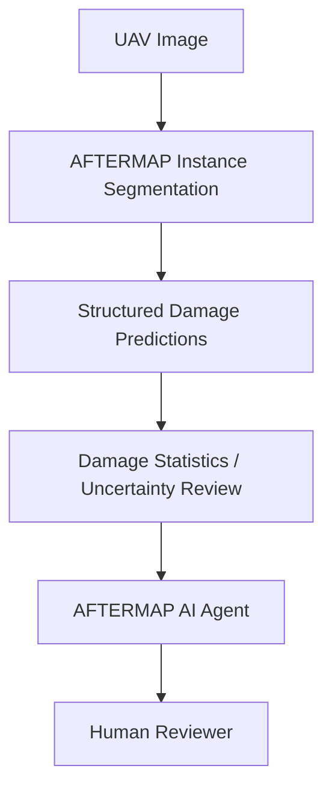

# AFTERMAP AI Agent

### Agentic AI for UAV-Based Post-Disaster Damage Assessment

## Short Overview

AFTERMAP AI Agent is a research demonstration that combines the AFTERMAP UAV damage-segmentation model with an AI reasoning layer to summarize damage predictions, highlight severe and uncertain cases, and support human-in-the-loop post-disaster assessment.

A user uploads a UAV disaster image, and the AFTERMAP model performs instance segmentation to generate structured damage predictions. The AI agent interprets those results using damage statistics and confidence-aware review. Human review remains the final decision layer.

## Demo

**[Watch the AFTERMAP AI Agent Demo](https://youtu.be/Eh0y7U_-SBI)**

## Workflow

## Damage Classes

- Destroyed
- Major Damage
- Minor Damage
- Affected
- No Damage
- Tarp

## Key Capabilities

- UAV damage segmentation
- Class-wise damage statistics
- Severe-damage summary
- Confidence-aware review
- AI-generated interpretation
- Human-in-the-loop decision support

## Research Paper

[Read the related AFTERMAP paper](https://doi.org/10.3390/buildings16152943)

## Technology

Python • AFTERMAP • YOLO-based Instance Segmentation • Gemini API • Streamlit

## Disclaimer

Research prototype. AFTERMAP predictions and agent-generated interpretations are intended to support, not replace, expert post-disaster damage assessment.
